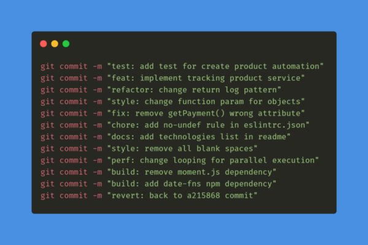

<div align="center">


</div>

<h1 align="center">PI-II-Time2</h1>

<p align="center">
  <strong>Sistema de Acompanhamento de Demandas de Desenvolvimento</strong><br>
  Projeto Integrador II · Engenharia de Software · PUC-Campinas<br>
  <sub>2º Semestre / 2026 · Turma 1</sub>
</p>

<p align="center">
  
  
  
  
  
  
  
</p>

---

## Sumário

- [Sobre o Projeto](#sobre-o-projeto)
- [Funcionalidades](#funcionalidades)
- [Regras de Negócio](#regras-de-negócio)
- [Tecnologias](#tecnologias)
- [Estrutura do Repositório](#estrutura-do-repositório)
- [Como Executar o Projeto](#como-executar-o-projeto)
- [Limitações Conhecidas](#limitações-conhecidas)
- [Equipe](#equipe)
- [Organização do Trabalho](#organização-do-trabalho)
- [Padrão de Commits](#padrão-de-commits)
- [Status do Projeto](#status-do-projeto)

---

## Sobre o Projeto

Este repositório contém o desenvolvimento de um **Sistema de Acompanhamento de Demandas
de Desenvolvimento**, inspirado nas ferramentas usadas por equipes de tecnologia para
organizar tarefas, defeitos (*bugs*), melhorias e documentação de um software.

A aplicação permite que **projetos** cadastrados possuam diversas **demandas** associadas,
cada uma com título, descrição, tipo, prioridade, responsável e status. As demandas podem
ser visualizadas, filtradas, comentadas e atualizadas conforme o perfil de acesso do
usuário, mantendo um **histórico completo de alterações**.

O sistema integra **frontend**, **backend** e **banco de dados relacional** em uma
aplicação funcional, desenvolvida ao longo do componente curricular Projeto Integrador II.

---

## Funcionalidades

### Gestão de Demandas

- Cadastrar, listar, visualizar detalhes e editar demandas
- Atualizar status ao longo do ciclo de vida
- Cancelar demandas — **sem exclusão física** de registros no banco
- Registrar comentários vinculados a demanda, usuário e data/hora
- Consultar o histórico automático de alterações

### Filtros e Buscas

- Filtragem por status, prioridade, tipo, responsável e projeto
- Busca textual por título ou descrição
- Ordenação por prioridade, data de criação, prazo de finalização ou status

### Dashboard

Tela inicial com indicadores resumidos:

| Indicador | Descrição |
|---|---|
| Total de demandas | Contagem geral de demandas cadastradas |
| Demandas por status | Abertas, em andamento, em revisão, concluídas e canceladas |
| Demandas por prioridade | Distribuição entre crítica, alta, média e baixa |
| Demandas por tipo | Distribuição entre tarefa, defeito, melhoria e documentação |
| Demandas críticas em aberto | Itens de prioridade crítica ainda não concluídos |
| Demandas próximas do prazo | Itens com prazo de finalização se aproximando |

### Autenticação e Perfis de Acesso

O sistema possui autenticação com **três perfis**, cada um com permissões distintas:

| Ação | Administrador | Líder de Projeto | Membro da Equipe |
|---|:---:|:---:|:---:|
| Visualizar projetos e demandas | Todos | Apenas vinculados | Apenas vinculados |
| Criar demandas | ✅ | Projetos vinculados | ❌ |
| Editar demandas | ✅ | Projetos vinculados | ❌ |
| Atribuir / alterar responsável | ✅ | Projetos vinculados | ❌ |
| Alterar prioridade | ✅ | Projetos vinculados | ❌ |
| Alterar status | Todas as transições | Todas as transições, nos projetos vinculados | *Aberta → Em andamento* e *Em andamento → Em revisão*, somente nas demandas em que é responsável |
| Concluir demandas | ✅ | Projetos vinculados | ❌ |
| Cancelar demandas | ✅ | Projetos vinculados | ❌ |
| Registrar comentários | ✅ | Projetos vinculados | Projetos vinculados |
| Visualizar histórico | ✅ | Projetos vinculados | Projetos vinculados |

As regras são conferidas nas telas (`js/permissoes.js`), que escondem ou bloqueiam
o que o perfil não pode fazer, e novamente na API, que recusa com `403` qualquer
requisição fora da permissão. O perfil e os vínculos com projetos são definidos
direto no banco.

---

## Regras de Negócio

### Ciclo de Vida da Demanda

```
                  ┌──────────────────────────────┐
                  │                              ▼
   [Aberta] ──▶ [Em andamento] ──▶ [Em revisão] ──▶ [Concluída]
       │              │                  │
       └──────────────┴──────────────────┴──────▶ [Cancelada]
```

- Toda demanda é criada automaticamente com o status **Aberta**
- **Não é permitido** concluir uma demanda diretamente de *Em andamento* — ela deve
  passar por *Em revisão*, simulando uma etapa de conferência, validação ou teste
- **Não é permitido** retornar de *Em andamento* para *Aberta*
- *Em revisão* pode voltar para *Em andamento* quando a conferência reprovar a entrega
- O cancelamento pode ocorrer a qualquer momento, desde que a demanda não esteja concluída
- O **Membro da Equipe** só realiza as transições *Aberta → Em andamento* e
  *Em andamento → Em revisão*, e somente nas demandas em que é o responsável
- Demandas *Concluídas* ou *Canceladas* não aceitam mais alterações

### Classificações

| Categoria | Valores |
|---|---|
| **Tipos** | Tarefa · Defeito · Melhoria · Documentação |
| **Prioridades** | Crítica · Alta · Média · Baixa |
| **Status** | Aberta · Em andamento · Em revisão · Concluída · Cancelada |

### Campos da Demanda

`título` · `descrição` · `tipo` · `prioridade` · `status` · `projeto associado` ·
`responsável` · `data de criação` · `data da última atualização` · `prazo de finalização`

- O campo **responsável** pode ficar em branco na criação, para atribuição posterior;
  quando informado, precisa estar vinculado ao projeto da demanda
- A **data de criação** é registrada automaticamente no cadastro
- A **data da última atualização** é modificada automaticamente a cada alteração relevante

### Integridade e Auditoria

- O **histórico de alterações** nunca é apagado, mesmo que a demanda seja cancelada
- **Não há exclusão física** de registros: demandas desnecessárias recebem o status
  *Cancelada*, preservando o histórico das atividades

### Validação de Prazo por API Externa

O prazo de finalização é validado contra uma **API externa de feriados nacionais**
([BrasilAPI](https://brasilapi.com.br/)), no cadastro e na edição da demanda. Caso a
data informada seja um feriado, o sistema exibe mensagem de erro e impede o cadastro
ou a atualização do prazo. Se a API externa estiver fora do ar, o prazo é aceito e a
tela exibe um aviso de que a conferência não pôde ser feita.

---

## Tecnologias

| Camada | Tecnologias |
|---|---|
| **Frontend** | HTML5, CSS3 *(estilos próprios, sem framework)*, JavaScript |
| **Backend** | Node.js (LTS), TypeScript, Express |
| **Banco de Dados** | Oracle Database *(relacional)* |
| **Versionamento** | Git, GitHub, GitHub Projects |
| **IDEs** | Visual Studio Code, JetBrains WebStorm |

---

## Estrutura do Repositório

```
PI-II-Time2/
├── backend/               # API (Node.js, TypeScript, Express)
│   ├── src/
│   │   ├── servidor.ts    # Ponto de entrada da API
│   │   ├── bd.ts          # Conexão com o Oracle (pool) usada pelas rotas
│   │   ├── senha.ts       # Hash e conferência de senha (scrypt)
│   │   ├── tipos.ts       # Listas oficiais (tipo, prioridade e status)
│   │   └── rotas/         # Um arquivo de rota por integrante
│   │       ├── index.ts           # Junta as rotas de todos os arquivos
│   │       ├── apoioDemandas.ts   # Funções compartilhadas (validação, feriados, permissão)
│   │       ├── login.ts           # POST /login e GET /usuarios
│   │       ├── cadastroUsuarios.ts
│   │       ├── dashboard.ts
│   │       ├── listagemDemandas.ts
│   │       ├── cadastroDemandas.ts
│   │       ├── detalhesDemandas.ts
│   │       └── edicaoDemandas.ts
│   ├── .env.example       # Modelo da configuração de conexão com o banco
│   ├── package.json
│   └── tsconfig.json
├── database/              # Scripts do banco de dados Oracle
│   ├── schema.sql         # Criação das 6 tabelas
│   ├── seed.sql           # Carga inicial (usuários, projetos, demandas...)
│   └── consultas.sql      # Consultas de conferência (somente leitura)
├── css/                   # Estilos de cada tela
│   ├── cadastro.css
│   ├── dashboard.css
│   ├── demanda.css
│   ├── listagem.css
│   ├── login.css
│   └── sessao.css         # Barra do usuário logado e menu das telas internas
├── js/                    # Comportamento das telas, validações e chamadas à API
│   ├── cadastro.js        # Cadastro de usuário (POST /usuarios)
│   ├── dados.js           # Constantes, usuário logado e chamada à API (chamarApi)
│   ├── dashboard.js       # Indicadores da tela inicial
│   ├── login.js           # Login (POST /login)
│   ├── demanda.js         # Cadastro, edição, comentários e histórico da demanda
│   ├── formato.js         # Funções de formatação reutilizáveis
│   ├── listagem.js        # Filtros, busca e ordenação
│   ├── permissoes.js      # Regras de acesso por perfil
│   ├── sessao.js          # Barra do usuário logado, "Sair" e menu por perfil
│   ├── validacoes.js      # Regras de validação de demandas e de filtros
│   └── validacoes.test.js # Autoteste das regras de validação
├── pages/                 # Telas do sistema
│   ├── cadastro.html
│   ├── dashboard.html
│   ├── demanda.html
│   ├── listagem.html
│   └── login.html
├── docs/
│   ├── Plano_Banco_de_Dados.pdf  # Modelo, arquitetura e cronograma do banco
│   ├── conventional-commits.png  # Exemplos do padrão de commits
│   ├── logo-puc.png
│   └── reunioes/          # Documento de visão, cronograma e atas de reunião
├── index.html             # Ponto de entrada (redireciona para o login)
├── .gitignore
└── README.md
```

> Todas as telas usam a API, e todas as rotas da API leem e gravam no banco
> Oracle; não há mais dados simulados no frontend nem dados em memória no backend.
>
> O [plano do banco de dados](docs/Plano_Banco_de_Dados.pdf) foi escrito para
> MySQL; o modelo de 6 tabelas foi mantido, mas o banco adotado é o Oracle,
> como pede a Reunião 5. A referência atual são os scripts da pasta `database/`.

---

## Como Executar o Projeto

### Pré-requisitos

- [Node.js](https://nodejs.org/) — versão LTS vigente
- [Oracle Database](https://www.oracle.com/database/technologies/xe-downloads.html) —
  a edição gratuita Express Edition (XE) 21c é suficiente
- [Git](https://git-scm.com/)

### Clonando o repositório

```bash
git clone https://github.com/Nathan-Kenzo/PI-II-Time2.git
cd PI-II-Time2
```

### 1. Criando o banco de dados

Os comandos abaixo usam o SQL\*Plus, instalado junto com o Oracle XE. No XE o
banco da aplicação é o `xepdb1`.

**1.1. Criar o usuário da aplicação.** Conecte como administrador (a senha é a
definida na instalação do Oracle):

```bash
sqlplus system@localhost:1521/xepdb1
```

```sql
CREATE USER demandatrack IDENTIFIED BY "escolha_uma_senha";
GRANT CREATE SESSION, CREATE TABLE, CREATE SEQUENCE TO demandatrack;
ALTER USER demandatrack QUOTA UNLIMITED ON USERS;
EXIT
```

A aplicação usa esse usuário, que só tem permissão sobre as próprias tabelas,
em vez do administrador do banco.

**1.2. Criar as tabelas e a carga inicial.** Na raiz do repositório, informe ao
SQL\*Plus que os scripts estão em UTF-8 (por causa dos acentos) e rode os dois
arquivos, nesta ordem. A primeira linha muda conforme o terminal:

| Terminal | Primeira linha |
|---|---|
| Prompt de Comando (cmd) | `set NLS_LANG=.AL32UTF8` |
| PowerShell | `$env:NLS_LANG = ".AL32UTF8"` |
| Git Bash | `export NLS_LANG=.AL32UTF8` |

```bat
set NLS_LANG=.AL32UTF8
sqlplus demandatrack@localhost:1521/xepdb1
```

```sql
@database/schema.sql
@database/seed.sql
EXIT
```

> [!IMPORTANT]
> Sem o `NLS_LANG` os scripts rodam sem erro, mas os acentos são gravados
> errados (`Portal Acadêmico`) e o cadastro de demanda passa a falhar. Se isso
> acontecer, defina a variável e rode os dois scripts de novo.

O `schema.sql` cria as 6 tabelas (`usuario`, `projeto`, `usuario_projeto`,
`demanda`, `comentario` e `historico`) e o `seed.sql` grava 5 usuários,
3 projetos, 16 demandas, 5 comentários e o histórico de criação. Os dois podem
ser rodados de novo a qualquer momento para voltar ao estado inicial; como as
datas das demandas são calculadas a partir do dia da carga, isso também renova
os prazos próximos e vencidos.

Usuários de demonstração gravados pelo `seed.sql`:

| Perfil | E-mail | Senha | Projetos |
|---|---|---|---|
| Administrador | `nathan@demandatrack.com` | `admin123` | todos |
| Líder de Projeto | `pedro@demandatrack.com` | `lider123` | DemandaTrack |
| Líder de Projeto | `henrique@demandatrack.com` | `lider456` | Portal Acadêmico, App de Biblioteca |
| Membro da Equipe | `felipe.barbosa@demandatrack.com` | `membro123` | DemandaTrack |
| Membro da Equipe | `felipe.santos@demandatrack.com` | `membro456` | DemandaTrack, Portal Acadêmico |

No banco as senhas ficam gravadas como hash (`scrypt`), nunca em texto puro.

### 2. Configurando a conexão

Copie o modelo e preencha a senha escolhida no passo 1.1:

```bat
cd backend
copy .env.example .env
```

No Git Bash, o segundo comando é `cp .env.example .env`.

```
BD_USUARIO=demandatrack
BD_SENHA=escolha_uma_senha
BD_CONEXAO=localhost:1521/xepdb1
```

O arquivo `.env` está no `.gitignore` e não é enviado ao repositório.

### 3. Executando o backend

```bash
cd backend
npm install
npm run dev
```

O servidor sobe em http://localhost:3000. Ao abrir essa URL no navegador,
aparece a mensagem "API do DemandaTrack funcionando".

Rotas da API (todas leem e gravam no Oracle):

| Método | Rota | Descrição |
|---|---|---|
| `POST` | `/login` | Autenticação por e-mail e senha; devolve o `usuario` com os `projetos` (ids) vinculados |
| `GET` | `/usuarios` | Lista de usuários, sem e-mail e sem senha (`?projetoId=` filtra os vinculados ao projeto) |
| `POST` | `/usuarios` | Cadastro de usuário (senha gravada como hash); o usuário novo entra como Membro da Equipe, sem projeto |
| `GET` | `/projetos?usuarioId=` | Projetos que o usuário pode ver |
| `GET` | `/dashboard?usuarioId=` | Indicadores da tela inicial, filtrados pelo perfil |
| `GET` | `/demandas?usuarioId=` | Listagem com filtros, busca e ordenação, filtrada pelo perfil |
| `POST` | `/demandas` | Cadastro de demanda (valida prazo na API de feriados) |
| `GET` | `/demandas/:id?usuarioId=` | Detalhes de uma demanda |
| `GET` | `/demandas/:id/comentarios?usuarioId=` | Comentários da demanda |
| `POST` | `/demandas/:id/comentarios` | Registro de comentário (`usuarioId` e `texto`) |
| `GET` | `/demandas/:id/historico?usuarioId=` | Histórico de alterações da demanda |
| `PATCH` | `/demandas/:id` | Edição da demanda (confere permissão, fluxo de status e feriado; grava o histórico) |

O `usuarioId` identifica quem faz o pedido. Sem um usuário válido a API responde
`401`; quando o usuário não está vinculado ao projeto da demanda, ou o perfil não
permite a ação, responde `403`. No `POST /demandas` o Membro da Equipe recebe
`403`, e o Líder de Projeto só cria nos projetos em que está vinculado. Cada
demanda criada ou alterada gera registros no histórico.

### 4. Abrindo o frontend

Com o backend rodando, abra o `index.html` (que redireciona para a tela de login)
ou direto o `pages/login.html` no navegador — de preferência pela extensão
**Live Server** do VS Code — e entre com um dos usuários de demonstração da
tabela acima. Todas as telas (dashboard, listagem, cadastro e edição de demanda,
comentários, histórico e cadastro de usuário) buscam e gravam os dados pela API;
as mensagens de erro devolvidas pela API aparecem na própria tela.

> [!TIP]
> Se o navegador mostrar uma versão antiga de alguma tela, recarregue com
> **Ctrl+F5** para ignorar o cache.

### Rodando os autotestes

As regras de validação (`js/validacoes.js`) e o hash de senha
(`backend/src/senha.ts`) têm autotestes que rodam no Node, sem navegador e sem
biblioteca de teste. Eles falham se alguma regra deixar de valer:

```bash
cd backend
npm test
```

---

## Limitações Conhecidas

- **Identificação do usuário:** a API identifica quem faz o pedido pelo
  `usuarioId` enviado pelo próprio frontend, sem token nem sessão no servidor.
  As permissões são conferidas na API a partir desse id, o que é adequado ao
  escopo acadêmico do projeto, mas não impede que alguém chame a API informando
  o id de outro usuário.
- **Recuperação de senha:** não há recuperação nem troca de senha pelo sistema.
- **Gestão de usuários:** o perfil e os vínculos com projetos são definidos
  direto no banco; não há tela de administração para isso.

---

## Equipe

| Nome Completo | GitHub |
|---|---|
| Nathan Kenzo Puzipe | [@Nathan-Kenzo](https://github.com/Nathan-Kenzo) |
| Felipe Oliveira Barbosa | `null` |
| Pedro Tiezo Sales Shimizu | [@Tiez0](https://github.com/Tiez0) |
| Henrique Aguiar de Souza Pella | [@henriquepella](https://github.com/henriquepella) |
| Felipe Oliveira dos Santos | [@FelipeOS6](https://github.com/FelipeOS6) |

**Professora Orientadora:** [Renata Arantes](https://github.com/RenataArantes)

---

## Organização do Trabalho

O acompanhamento das atividades é feito pelo **GitHub Projects** deste repositório,
onde são registradas todas as tarefas e as horas dedicadas ao projeto.

### Fluxo de Branches

O desenvolvimento segue o conceito de *feature branches*: cada funcionalidade é
desenvolvida em uma ramificação exclusiva e integrada à `main` somente após estar
funcionando.

```bash
git checkout -b feat/autenticacao   # cria a branch da funcionalidade
# ... desenvolvimento e commits ...
git checkout main
git merge feat/autenticacao         # integra na main
```

### Reuniões de Orientação

Reuniões de acompanhamento às **segundas-feiras, às 07:10h**:

| # | Data | Status |
|:-:|---|---|
| 1 | 17/08/2026 | ✅ Realizada |
| 2 | 31/08/2026 | ✅ Realizada |
| 3 | 21/09/2026 | ✅ Realizada |
| 4 | 19/10/2026 | ✅ Realizada |
| 5 | 16/11/2026 | ✅ Realizada |

---

## Padrão de Commits

O projeto utiliza **Conventional Commits** no formato `tipo: descrição`:

| Tipo | Quando usar |
|---|---|
| `feat` | Nova funcionalidade |
| `fix` | Correção de defeito |
| `docs` | Documentação |
| `style` | Formatação, sem mudança de lógica |
| `refactor` | Refatoração sem alterar comportamento |
| `test` | Testes |
| `perf` | Melhoria de performance |
| `build` | Dependências e build |
| `chore` | Configurações e manutenção |
| `revert` | Reversão de um commit anterior |

<div align="center">



</div>

### Autoria dos Artefatos

Todo arquivo do projeto contém, no topo, a **identificação do autor** responsável e
comentários explicativos sobre o código.

```typescript
/**
 * Autor: Nome Completo do Integrante
 * Descrição: responsabilidade deste arquivo
 */
```

---

## Status do Projeto

🔵 **Em fase final** — sistema funcional de ponta a ponta: todas as telas usam a API, e a API lê e grava no banco Oracle. Falta a release final.

- [x] Criação do repositório no GitHub
- [x] Inclusão dos integrantes e da professora orientadora
- [x] Configuração inicial do GitHub Projects
- [x] Criação e organização do `README.md`
- [x] Configuração e teste do ambiente Git/GitHub pelos integrantes
- [x] Telas de login e cadastro de usuário
- [x] Tela de dashboard com indicadores
- [x] Tela de listagem com filtros, busca e ordenação
- [x] Tela de demanda (cadastro, edição, comentários e histórico)
- [x] Estrutura do backend (Express + TypeScript)
- [x] Plano de implementação do banco de dados
- [x] Implementação da API (backend) — login, usuários, dashboard, listagem, cadastro, detalhes e edição
- [x] Modelagem e criação do banco de dados Oracle (`database/`)
- [x] Integração do frontend com a API — todas as telas
- [x] Migração das rotas para o banco — todas as rotas no Oracle
- [x] Validação de prazo pela API de feriados (no cadastro e na edição)
- [x] Controle de acesso por perfil na API e nas telas
- [x] Integração e testes
- [ ] Release final `1.0.0-final`

---

<p align="center">
  Desenvolvido pelo <strong>Time 2</strong> — Projeto Integrador II · PUC-Campinas · 2026<br>
  <sub>Última atualização deste documento: 21/11/2026</sub>
</p>
